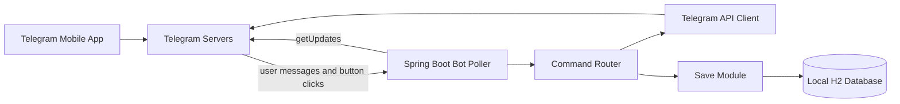

# DayMateBotAssistant

DayMate is a Telegram daily planner. Telegram is the user interface. Spring Boot polls Telegram, routes commands, and saves tasks in a local H2 database.

## What you can do

| Command | Action |
| --- | --- |
| `/start` | Welcome and command list |
| `/today` | Today's agenda and progress (`2/5 done`) |
| `/add` | Create a task: title → category → priority → due time → repeat |
| `/done` | Mark a task complete (buttons or `/done T-001`) |
| `/list` | Pending tasks plus completed today |
| `/recurring` | Daily and weekly repeating tasks |
| `/help` | Help |
| `/cancel` | Cancel an add-task flow |
| `/id` | Print your numeric Telegram user ID |

Each task has an ID (`T-001`), category (Work, Personal, Health), priority (High, Medium, Low), due time, status (Pending, In Progress, Completed), and optional daily or weekly recurrence.

Inline buttons on `/today`:

- **Start** / **Complete** / **Snooze** (1 hour) / **Delete** per task
- **Mark all done** / **Add task** / **Refresh**

## Architecture



| Piece | Class | Role |
| --- | --- | --- |
| Spring Boot Bot Poller | `poller.BotPoller` | Long-polls `getUpdates` |
| Command Router | `router.CommandRouter` | Commands, callbacks, add-task conversation |
| Telegram API Client | `telegram.TelegramApiClient` | `sendMessage`, `editMessageText`, `answerCallbackQuery` |
| Save Module | `save.TaskSaveService` | Tasks, public IDs, recurrence spawn |
| Local H2 Database | `./data/daymate-bot` | Tasks, conversation state, poll offset |

## Requirements

- Java 17
- Maven 3.9+
- A bot token from [@BotFather](https://t.me/BotFather)

In BotFather, set the command list:

```
start - Welcome and command list
today - View today's tasks
add - Add a new task
done - Mark a task as complete
list - List all pending tasks
recurring - Show repeating tasks
help - Show help
cancel - Cancel the current action
id - Show your Telegram user ID
```

## Run

From this folder in PowerShell:

```powershell
$env:JAVA_HOME = "D:\tools\jdk-17.0.20.1+1"
$env:TELEGRAM_BOT_TOKEN = "your-token-from-BotFather"
D:\tools\apache-maven-3.10.0\bin\mvn.cmd spring-boot:run
```

Open the bot in Telegram and send `/start`.

Optional:

```powershell
$env:TELEGRAM_ALLOWED_USER_IDS = "123456789"
$env:TELEGRAM_BOT_TIMEZONE = "Asia/Bangkok"
$env:TELEGRAM_DIGEST_ENABLED = "true"
```

- `TELEGRAM_ALLOWED_USER_IDS` — comma-separated numeric user IDs. Empty means every user has their own task list.
- `TELEGRAM_DIGEST_ENABLED` — send the `/today` agenda at 08:00 in the bot timezone.

H2 files are stored under `data/daymate-bot` in the working directory.

## Add-task conversation

1. `/add` → *What's the title of your task?*
2. Category buttons: Work, Personal, Health
3. Priority buttons: High, Medium, Low
4. Due time: `5:00 PM`, `17:00`, `tomorrow`, or `skip`
5. Repeat: None, Daily, Weekly

Completing a daily or weekly task creates the next occurrence.

## REST API

The server binds to `127.0.0.1:8080` by default. Useful for local testing without Telegram.

```http
GET  /health
GET  /api/bot/status
GET  /api/tasks?telegramUserId=1
GET  /api/tasks/today?telegramUserId=1
POST /api/tasks
POST /api/tasks/T-001/start?telegramUserId=1
POST /api/tasks/T-001/complete?telegramUserId=1
POST /api/tasks/T-001/snooze?telegramUserId=1
DELETE /api/tasks/T-001?telegramUserId=1
```

Example create:

```json
{
  "telegramUserId": 1,
  "chatId": 1,
  "title": "Buy groceries",
  "category": "PERSONAL",
  "priority": "MEDIUM",
  "dueTime": "5:00 PM",
  "recurrence": "NONE"
}
```

## Tests

```powershell
$env:JAVA_HOME = "D:\tools\jdk-17.0.20.1+1"
D:\tools\apache-maven-3.10.0\bin\mvn.cmd test
```

## Production (port 8000)

The server uses Spring profile `prod`, binds `0.0.0.0:8000`, and stores the H2 database under `/var/lib/daymate/data`.

```bash
sudo bash deploy/setup-server.sh
# set TELEGRAM_BOT_TOKEN in /etc/daymate/daymate.env
sudo systemctl restart daymate
curl http://127.0.0.1:8000/health
```

Do not commit the bot token. Keep it in `/etc/daymate/daymate.env` on the host.

## CI/CD

GitHub Actions (`.github/workflows/ci-cd.yml`) runs tests on every push and pull request. Pushes to `main` package the jar, copy it to the server, and restart `daymate.service`.

Required repository secrets:

- `SERVER_HOST` — server IP or hostname
- `SERVER_USER` — SSH user (`ubuntu`)
- `SSH_PRIVATE_KEY` — deploy private key (PEM)
